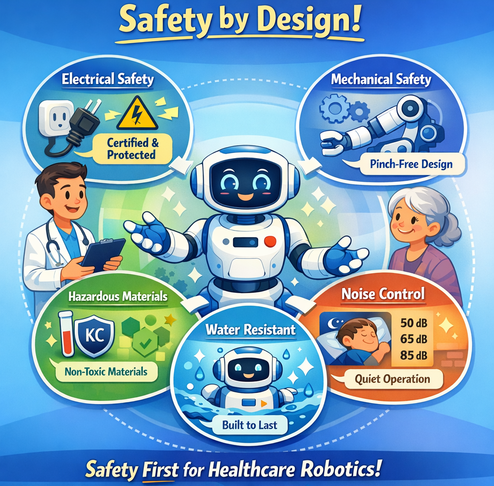

Here is a quick look at the essential layers of protection:

⚡ Electrical Safety: Leakage current, voltage tolerance, and over-temperature protection. This also includes battery safety and emergency stops.

⚙️ Mechanical Safety: The structure is designed to prevent pinching or squeezing, ensuring the user is never at risk of physical harm.

🧪 Hazardous Materials: For parts that touch the human body, hazardous substances are strictly limited.

🔊 Noise Control: Peace of mind also means peace and quiet! The limits are clear: 50 dB in sleeping areas, 65 dB indoors, and 85 dB outdoors.

💧 Environment: Finally, water resistance is classified according to IEC 60529 to ensure durability.

Safety isn't just about compliance; it's about creating harmony between humans and machines. 🌟

