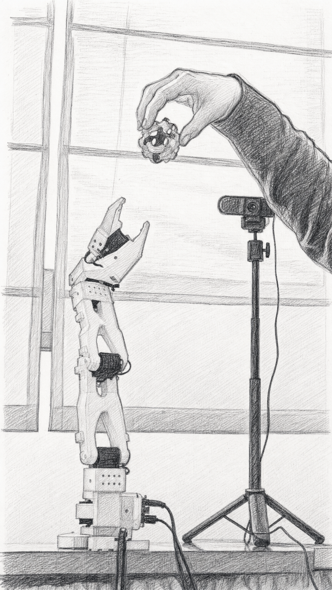
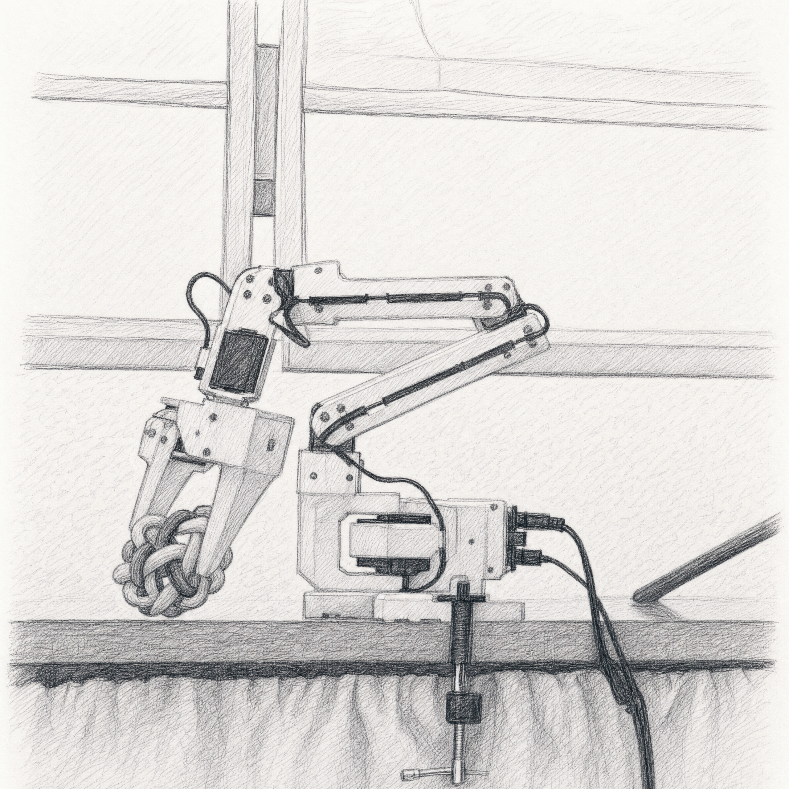
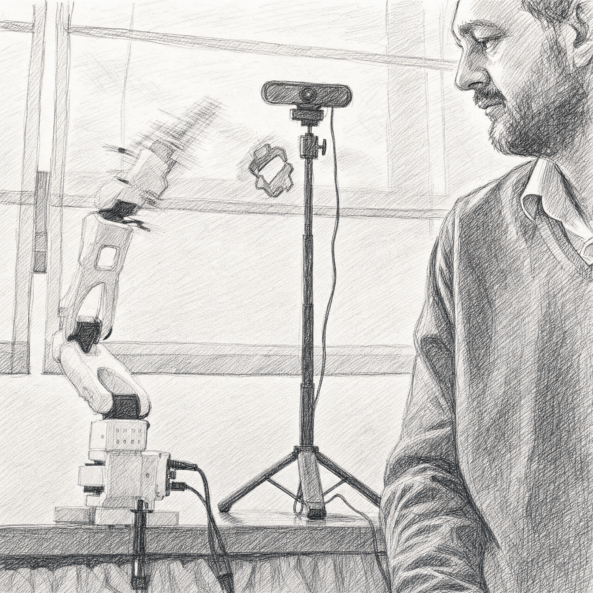
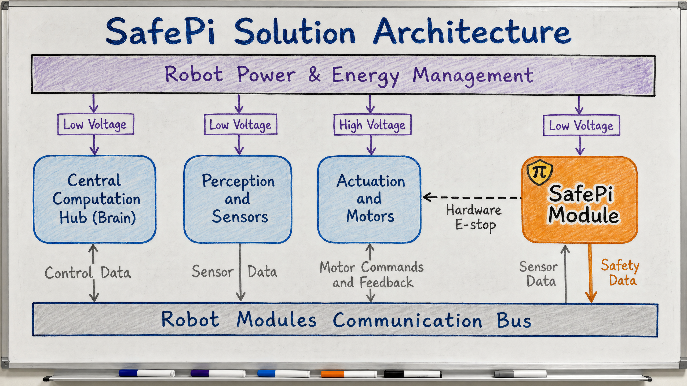

See the video on our [YouTube Chanel](https://www.youtube.com/watch?v=ldqd7yaZNKs)

#Our goal is to make humanoid robots safe in home environments.

To get there, we start with the Hiwonder robotic arm, which allows us to explore many of the same safety challenges that apply to humanoid robot manipulation.
You can train it to hold your phone, bring you an apple, or even play ball with your dog.
But even these simple tasks introduce some very real safety challenges.

**First, a human hand enters the robot's workspace.**
We must ensure that the robot detects it and prevents harmful contact.

**Second, collisions.**
A robot can cause the arm to collide with a table, a wall, or other furniture.

**Third, the robot throws or accidentally releases an object.**
The resulting projectile should not injure anyone or damage anything.

To address these challenges, we are developing an independent safety module to be integrated directly into the robot's ecosystem.
When a potential hazard or safety-boundary violation is detected, the module broadcasts real-time safety information.

It can also interface with the hardware emergency-stop layer to trigger immediate intervention when necessary.
Our approach follows a structured five-step pipeline: asset declaration, exposure mode identification, hazard scenario definition, digital twin and synthetic data generation, and finally, safety envelope learning.

*Our vision is simple: make robots understand not only what they can do, but also what they must never do.*
