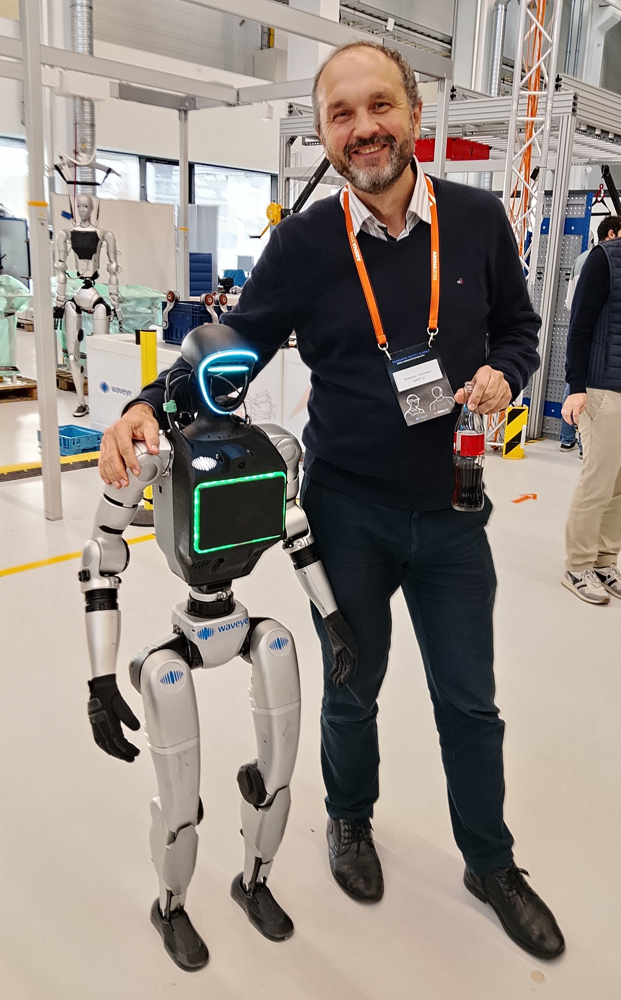
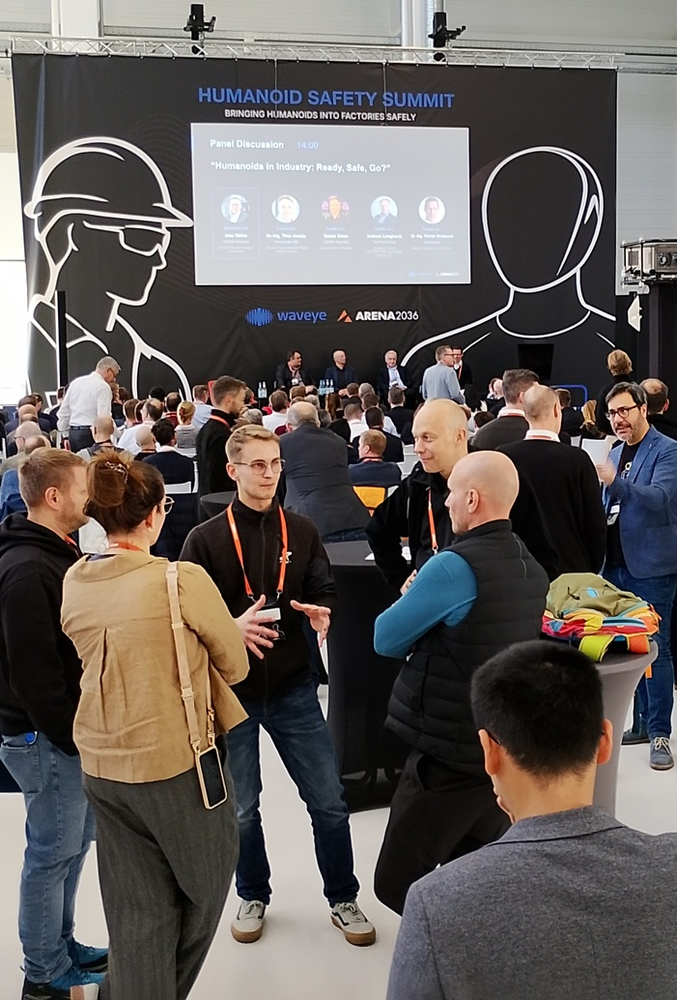
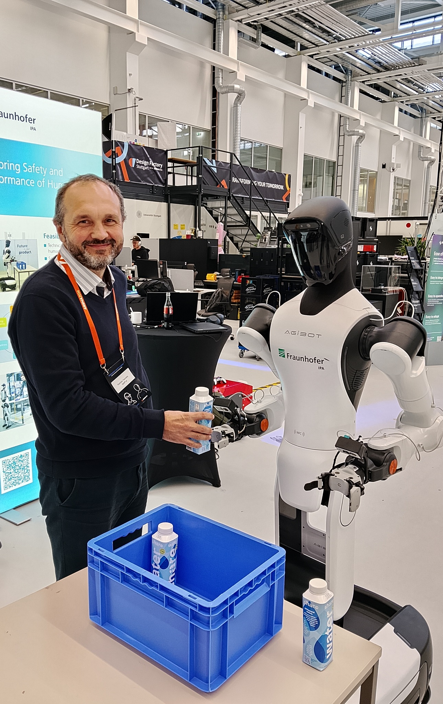

Last week, our Head of Research, [Rostislav Yavorskiy](https://www.linkedin.com/in/ryavorsky/), 
attended the prestigious Humanoid Safety Summit 
hosted at [ARENA2036 in Stuttgart](https://arena2036.de/en/reader/humanoid-safety-summit/).

The event brought together heavy hitters from across the robotics and manufacturing landscape, 
including presentations and strategic discussions from Boston Dynamics, Agility Robotics, 
Mercedes-Benz Cars, and the Association for Advancing Automation (A3).

The summit also hosted the ISO 299/WG 12 working group 
on "Safety for Dynamically Stable Industrial Mobile Robots," placing the discussions directly at the 
forefront of global regulatory development.

The insights and connections gained directly inform our internal R&D roadmap, ensuring that our upcoming 
innovations align seamlessly with international safety standards and real-world industrial needs.

We look forward to leveraging these collaborative insights as we continue pushing the boundaries of intelligent, 
safe robotics!

